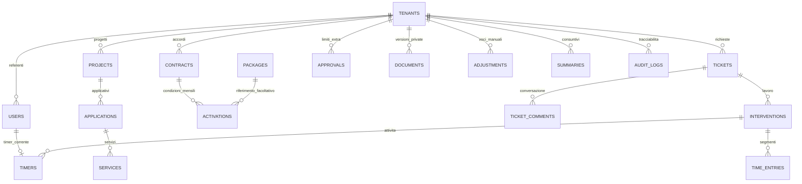

# Architettura VP Developer Hub

Monolite Laravel 13 / PHP 8.4, PostgreSQL 16+, Blade e Tailwind. Pannello amministratore e portale cliente condividono componenti e servizi applicativi. Nessuna dipendenza dai software dei clienti.

## Confini di sicurezza

`tenant_id` identifica l'azienda. Scope Eloquent fail-closed, autorizzazioni server per capacità e vincoli relazionali composti impediscono associazioni fra aziende. L'amministratore globale opera su tutti i tenant; amministratori e utenti cliente soltanto sul proprio. File su disco privato, scaricati tramite controller autorizzato. Nessuna registrazione pubblica. Fortify gestisce login, reset password e MFA TOTP; MFA obbligatoria per super admin.

## Contabilità e tempo

Denaro in centesimi interi, tempo in secondi. Ogni attivazione mensile conserva una copia delle condizioni economiche e diventa immutabile dopo l'approvazione. Nessuna attivazione automatica dei pacchetti demo. Gli extra richiedono un'approvazione esplicita con limite di tempo e importo. Il riepilogo distingue importi autorizzati e tempo in attesa di autorizzazione. Il consolidamento mensile blocca correzioni retroattive; emissione e pagamento sono stati distinti.

Un solo timer per operatore. Le operazioni acquisiscono un lock sulla riga dell'operatore, serializzando anche inserimenti manuali e correzioni. Le registrazioni usano intervalli semiaperti [inizio, fine); sovrapposizioni sono rifiutate. Le pause materializzano segmenti, il riavvio apre un segmento nuovo. I totali tagliano i segmenti ai confini del mese in Europe/Rome. Attività non fatturabili rimangono visibili senza consumare il monte ore.

## Moduli

Aziende e referenti; progetti, applicativi e servizi; contratti e catalogo pacchetti; attivazioni mensili; interventi e registrazioni; ticket, commenti e approvazioni; documenti versionati; consuntivi e audit. Notifiche email in coda configurabili. Scheduler per riepiloghi e pulizia controllata dei dati effimeri.

## Deployment

Container separati web, worker e scheduler, PostgreSQL persistente, volume privato condiviso per file. HTTPS terminato da Coolify, database non esposto. Migrazioni eseguite come attività di rilascio. Nessuna pubblicazione o modifica DNS automatica. Backup di database, file e chiave applicativa con ripristino documentato e verifica periodica.

## Schema relazionale

`User::allowed()` centralizza le capacità dei tre ruoli; `HubAccess` verifica account/azienda attivi e MFA amministratore a ogni richiesta del workspace. `TenantModel` applica scope di lettura e identificativo tenant per creazione cliente; i controller verificano esplicitamente le relazioni prima di scrivere. `Tenant` usa uno scope sul proprio ID. `User` non ha uno scope globale per consentire login: tutte le operazioni di team filtrano esplicitamente tenant e ruoli ammessi.

`ResourceController` usa una definizione chiusa delle risorse e dei campi (`Support/Resources.php`): l’URL non può selezionare classi o tabelle arbitrarie. Le logiche economiche e di tempo restano in servizi dedicati e non vengono affidate al CRUD generico. Non sono esposte API pubbliche o token API nella prima versione: il frontend leggero usa endpoint web con sessione e CSRF.

Il lock per operatore precede il lock tenant nelle operazioni di tempo. Consolidamento, attivazioni, approvazioni e modifiche economiche acquisiscono il lock tenant. Le modifiche dell’intervento verificano tutte le sue registrazioni prima di cambiare criteri di consumo. Il campo `uses_package` conserva la classificazione effettiva; modificare in seguito il catalogo categorie non riclassifica implicitamente le registrazioni storiche.

Tutti gli istanti sono salvati in UTC e la connessione PostgreSQL imposta esplicitamente UTC; date contrattuali e mesi sono date civili. Il fuso di presentazione/contabilità è Europe/Rome. Le attivazioni coprono mesi interi e la prima versione permette un solo accordo economico per azienda/mese. Più applicativi del cliente condividono quel monte ore; contratti simultanei con pacchetti separati per applicativo richiedono un’evoluzione del modello.

Filament non è utilizzato: Blade con componenti condivisi mantiene l’interfaccia coerente fra aree e riduce le dipendenze. Fortify fornisce i flussi di autenticazione, DomPDF i PDF locali. Non sono presenti microservizi o integrazioni infrastrutturali remote.
